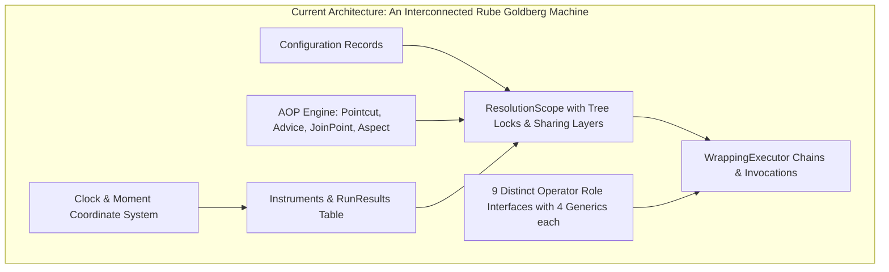
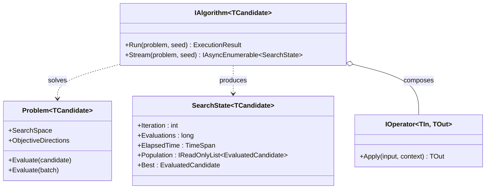

# Comprehensive Architectural Analysis: Minimalist Unification for HeuristicLib

---

## 1. Executive Summary: The Crisis of Accidental Complexity

### 1.1 The "Scikit-Learn" Contrast
Scikit-learn is widely regarded as one of the best-designed machine learning libraries in history. Its power and ergonomics stem from a radical adherence to a tiny set of orthogonal concepts:
- **`Estimator`**: has `fit(X, y)`
- **`Predictor`** (Classifier/Regressor): has `predict(X)`
- **`Transformer`**: has `transform(X)`
- **Composition**: A `Pipeline` or `GridSearchCV` is itself just an `Estimator`.
- **Convention over Machinery**: Hyperparameters are set in `__init__`; learned states are public fields (e.g., `coef_`); inspectability is built into the output arrays and plain dictionaries.

In contrast, an author looking at the HeuristicLib glossary today finds over **50 distinct conceptual abstractions**:
*Configuration nodes, Execution nodes, Executors, Pointcuts, Advice, Join points, Aspects, Wrapper chains, Invocation wrappers, Operation descriptors, Item operations, Resolution scopes, Scope layers, Child scopes, Building layer rules, Sharing layers, Conflict guards, Resource handles, Supplied handles, Run resources, Instruments, Run results, Traces, Clocks, Moments, Time, Retention deciders, Accumulators, Observation sources, Observation points, IterativeAlgorithmExecutors, and 9 distinct Operator Role hierarchies.*

Even assuming the current branch plan (default sharing, scope-as-the-sharing-unit, run-bound instruments, and AOP wrapper synthesis) is completely implemented:
> **The library has built an entire internal operating system** (an IoC container with custom dynamic lifetime scopes, an Aspect-Oriented compiler, and an orthogonal multi-dimensional relativistic time/moment telemetry engine) **just to run a metaheuristic loop.**

### 1.2 The Root Cause: Solving Corner-Cases with New Mechanisms
Every time a valid edge case arose—such as:
1. *"How do we share a cache across `CycleAlgorithm` turns without leaking it across separate runs?"*
2. *"How do we measure operator invocations without altering the algorithm loop?"*
3. *"How do we terminate when an operator exceeds 10,000 evaluations?"*
4. *"How do we trace best-so-far fitness alongside iterations and elapsed wall time?"*

—the architecture added a **new subsystem** (`ResourceHandles` $\rightarrow$ `ResolutionScope.Sharing` $\rightarrow$ `Aspects/Pointcuts` $\rightarrow$ `Instruments/RunResults` $\rightarrow$ `Clock/Moment/RetentionDecider`) rather than relying on standard, idiomatic Object-Oriented patterns (Encapsulation, Decorator Pattern, Factory/Compilation, and Observability Streams).

---

## 2. Deconstruction: The Four Engines of Complexity

Let us look honestly at the current architecture (including the completed branch plan) and see where the accidental complexity lives.



### Engine 1: Aspect-Oriented Programming (AOP) Instead of Decorators
To avoid manually wrapping operators, the system introduced full AOP:
- Pointcuts match configurations by reference, type, or predicate.
- Advice wraps join points using `IOperation<TSelf>.Wrap(...)` and dynamic `IInvocationWrapper` structs.
- **The Failure of KISS/SOLID**: In C#, unlike dynamic languages or Java bytecode weavers, implementing AOP requires an enormous reflection-emulating superstructure (`IOperation<TSelf>`, `IInvocation<TResult>`, `WrappingExecutor`, `OperationInfo`). 
- It breaks the **Single Responsibility Principle**: configuration nodes must now understand aspect weaving and advice order. 
- It creates subtle ordering bugs: *"Does advice added later wrap closer?"*, *"What happens if advice matches a node already resolved in that scope?"*, *"Why does adding advice after child scope creation throw an exception?"*

### Engine 2: Dynamic Resolution Scopes Instead of Upfront Compilation
The user established a core desire:
> *"Separate the configuration graph (data-like C# records) and the execution graph (efficient dotnet objects without reflection or key lookups)."*

This principle is sound. But the current implementation did not implement a clean **Compiler/Builder**. Instead, it implemented a **Dynamic, Stateful IoC Container (`ResolutionScope`)**:
- Execution graphs are resolved on-the-fly.
- When `CycleAlgorithm` executes a turn, it calls `scope.CreateChildScope()` and resolves its children again.
- Because turns resolve dynamically, a whole framework was needed to decide whether an executor is recreated or reused: `Sharing(x)`, building layers, scope trees, locks (`node.Tree.Sync.EnterScope()`), and resolution conflict detection.
- **The Irony**: In a library aiming for zero overhead and high-performance execution, every resolution step acquires locks, checks hash sets of `Advised` nodes, validates against `adder` references, and traverses scope hierarchies.

### Engine 3: Multi-Dimensional Telemetry (Clocks, Moments, Retention)
To record a simple convergence curve (e.g., best fitness vs. evaluations), HeuristicLib created:
- `Clock<TTime>`, `Time`, `Moment`, `TraceRetention`, `RetentionDecider`, `AccumulatingAnalyzer`, `ObservationSource`, `ObservationPoint`.
- A trace needs an `ObservationSource`, which triggers an `ObservationAdvice`, which writes to an `Instrument`, which samples one or more `Clocks` to assemble a composite `Moment`.
- In reality, in optimization algorithms, progress is naturally linear: each step produces a state. Yielding or streaming states that carry basic metrics eliminates 90% of this telemetry machinery.

### Engine 4: Role Explosion and Generic Type Parameter Arity
Currently, every operator role has its own interface and method signature:
```csharp
// Example from current code:
public interface ICrossoverExecutor<TCandidate, in TSearchSpace, in TProblem> : IOperatorExecutor
    where TSearchSpace : class, ISearchSpace<TCandidate>
    where TProblem : class, IProblem<TCandidate, TSearchSpace>
{
    IReadOnlyList<TCandidate> Cross(
        IReadOnlyList<Parents<TCandidate>> parents, 
        IRandomNumberGenerator random, 
        TSearchSpace searchSpace, 
        TProblem problem);
}
```
Notice:
1. Every method forwards `(random, searchSpace, problem)`. If an operator is already compiled for a problem, why does every call pass `problem` and `searchSpace`?
2. Why does crossover need to know about `TProblem`? Crossover combines genotypes; it has no business knowing about the problem's objective function.
3. Every role requires 4 generic parameters (`TCandidate, TSearchSpace, TProblem, TSearchState`), spawning dozens of lines of repetitive extension methods (`Resolve`, `ResolveOptional`, `TryResolve`).

---

## 3. The Minimalist Core: What HeuristicLib Truly Is

If we strip away all accidental mechanisms, what is the essential domain model of HeuristicLib?



In its fundamental form, HeuristicLib has only **Five Core Concepts**:

| Concept | Role in Library | Analog in Scikit-Learn |
| :--- | :--- | :--- |
| **1. Problem** | Defines the evaluation function, objective direction (min/max), and search space bounds. | The dataset `(X, y)` + `scoring` metric |
| **2. Candidate & State** | `Candidate` is the genotype/solution. `SearchState` is the immutable progress snapshot containing population, best candidate, iteration, evaluations, and elapsed time. | Learned attributes (`coef_`, `classes_`) + scoring results |
| **3. Operator** | A composable transformation step: Variation (Mutate/Cross), Selection, Evaluation, Replacement. | `Transformer` / Estimator step |
| **4. Algorithm** | A search process that repeatedly applies operators to advance `SearchState` until stopping criteria are met. | `Estimator` (e.g., `fit()`) |
| **5. Configuration vs. Execution** | **Configuration**: Pure immutable C# records (serializable to JSON/REST).<br>**Execution**: Concrete, fast C# objects compiled once upfront. | Estimator `__init__(params)` vs. fitted model execution |

---

## 4. Systems to Throw Out, Replace, or Keep

Applying the **KISS** (Keep It Simple, Stupid), **SOLID**, and **YAGNI** (You Aren't Gonna Need It) principles, here is the clear categorization of systems:

### 4.1 Systems to THROW OUT Completely

1. **Aspect-Oriented Programming (AOP) Engine (`Pointcut`, `Advice`, `JoinPoint`, `Aspect`)**
   - *Why*: Optimization algorithms are not enterprise web controllers. AOP introduces massive generic overhead, reflection simulation, and unpredictable action-at-a-distance.
   - *Alternative*: Standard **Decorator Pattern** (e.g., `CountedEvaluator`, `CachedEvaluator`, `BudgetedAlgorithm`) and direct explicit composition.

2. **Dynamic `ResolutionScope` Trees & Sharing Layers**
   - *Why*: Scopes, child scopes, building layer rules, and `Share()` were invented solely because the graph was being resolved dynamically on every Cycle turn.
   - *Alternative*: **Single-Pass Compilation**. The configuration record graph is compiled **once** into an execution object graph before the run starts. If two operators need to share a cache, the compiler creates one cache instance and passes it to both. Done.

3. **Multi-Dimensional Telemetry (`Clock`, `Time`, `Moment`, `TraceRetention`, `ObservationPoints`)**
   - *Why*: Over-engineered abstraction layer. 99% of optimization tracking is simply: *"At iteration $i$, after $e$ evaluations and $t$ seconds, the best quality was $q$."*
   - *Alternative*: The algorithm’s yielded `SearchState` already carries these metrics. Analyzing a run is as simple as:
     ```csharp
     var history = algorithm.Stream(problem)
                            .Select(s => new { s.Iteration, s.Evaluations, s.Best.ObjectiveVector })
                            .ToList();
     ```

4. **Resource Handles & Runtime Supply (`ResourceHandle<T>`, `SuppliedResourceHandle<T>`, `RunResources`)**
   - *Why*: Already marked provisional and recognized as invasive. 
   - *Alternative*: Execution objects hold their own state in fields. If external data is supplied, it is passed via the Problem or the Algorithm Configuration upfront.

5. **`IOperation<TSelf>` Reflection Emulation & `IInvocationWrapper`**
   - *Why*: A 400-line generic type machinery designed solely to enable AOP wrapping without reflection. Throwing out AOP makes this entirely redundant.

---

### 4.2 Systems to KEEP and SOLIDIFY (The Real Core)

1. **Configuration Graph as Pure Immutable C# Records**
   - **Keep**: `record GeneticAlgorithm<TCandidate>(...)`, `record RealUniformCrossover(...)`.
   - **Rule**: Configuration records are **100% pure data**. No delegates (`Func<...>`), no live handles, no mutable state.
   - **Benefit**: Trivially serializable to JSON/YAML for REST APIs, experiment persistence, and configuration files.

2. **Execution Graph as Direct .NET Objects**
   - **Keep**: Distinct execution objects compiled from configuration.
   - **Rule**: Direct virtual method calls. Private state in plain C# fields. Zero dictionary lookups, zero locks, zero dynamic reflection during execution.

3. **High-Performance Batch Operations**
   - **Keep**: Evaluating and mutating batches of candidates for SIMD/vectorization and multi-threading efficiency.

4. **Stream-Based Search Progress (`IAsyncEnumerable<SearchState>`)**
   - **Keep**: Algorithms stream search states as they progress. This supports cancellation, live UI updates, early stopping, and step-by-step debugging out of the box.

---

### 4.3 Systems to REPLACE & SIMPLIFY DRASTICALLY

#### A. Replace 9 Operator Roles with 4 Standard Semantic Shapes
Instead of 9 distinct interfaces with disparate signatures, operators fall into 4 simple functional patterns:

```csharp
namespace HeuristicLib.Core;

// 1. Transform (Mutation, Refinement, Repair): T -> T
public interface ITransformOperator<TCandidate>
{
    IReadOnlyList<TCandidate> Apply(IReadOnlyList<TCandidate> candidates, ExecutionContext context);
}

// 2. Recombination (Crossover): (T, T) -> T
public interface ICrossoverOperator<TCandidate>
{
    IReadOnlyList<TCandidate> Cross(IReadOnlyList<(TCandidate Parent1, TCandidate Parent2)> pairs, ExecutionContext context);
}

// 3. Selection / Replacement: Select a subset from an evaluated population
public interface ISelector<TCandidate>
{
    IReadOnlyList<EvaluatedCandidate<TCandidate>> Select(
        IReadOnlyList<EvaluatedCandidate<TCandidate>> population, 
        int count, 
        ExecutionContext context);
}

// 4. Evaluator: Turns Candidate into EvaluatedCandidate
public interface IEvaluator<TCandidate>
{
    IReadOnlyList<EvaluatedCandidate<TCandidate>> Evaluate(
        IReadOnlyList<TCandidate> candidates, 
        IProblem<TCandidate> problem, 
        ExecutionContext context);
}
```
*Note*: No `TSearchSpace` or `TProblem` cluttering crossover or mutator interfaces. An `ExecutionContext` simply carries `IRandomNumberGenerator` and a `CancellationToken`.

#### B. Replace AOP & Advice with Idiomatic Decorators
If you want an operator to count evaluations, cache results, or retry on failure, use standard OOP Decorators:

```csharp
// Configuration (Records):
var evaluator = new EvaluationConfig() with { Cache = true, Counted = true };

// Compilation simply builds:
// new CachedEvaluator(new CountingEvaluator(new ProblemEvaluator(problem), counter), cache);
```
Or at the algorithm level:
```csharp
var algorithm = new GeneticAlgorithmConfig { ... }
    .WithMaxEvaluations(10_000)
    .WithTimeLimit(TimeSpan.FromMinutes(2));
```
Every decorator is a standard, transparent object that wraps another object of the *same* interface. Clean, predictable, debuggable, and zero AOP machinery.

---

## 5. How the Minimal Architecture Handles the "Corner Cases" Out of the Box

Let us review the exact corner-cases that previously caused architecture bloat and demonstrate how a clean OOP design solves them naturally.

### Corner-Case 1: State Sharing in Meta-Algorithms (e.g., `CycleAlgorithm` & Caches)
- **The Old Problem**: Algorithm A and Algorithm B run in a Cycle. We want them to share an evaluation cache across turns, but restart their iteration counts every turn.
- **Why it was complicated**: Cycle was destroying and rebuilding executors dynamically using child scopes and `Sharing` layers.
- **The Minimalist OOP Solution**:
  An execution graph is compiled **once**. 
  ```csharp
  // When compiling CycleAlgorithm:
  public class CycleAlgorithmExecutor<TCandidate> : IAlgorithmExecutor<TCandidate>
  {
      private readonly IAlgorithmExecutor<TCandidate> _algorithmA;
      private readonly IAlgorithmExecutor<TCandidate> _algorithmB;
      
      // Both algorithms receive the SAME compiled shared instance (e.g. Cache) in their constructor!
      public CycleAlgorithmExecutor(IAlgorithmExecutor<TCandidate> a, IAlgorithmExecutor<TCandidate> b)
      {
          _algorithmA = a;
          _algorithmB = b;
      }

      public async IAsyncEnumerable<SearchState<TCandidate>> RunAsync(...)
      {
          while (!Terminated)
          {
              // Algorithm A executes for a step/epoch; its internal turn state resets, 
              // but its shared references (cache) remain untouched!
              await foreach (var state in _algorithmA.RunTurnAsync(...)) yield return state;
              await foreach (var state in _algorithmB.RunTurnAsync(...)) yield return state;
          }
      }
  }
  ```
  **Result**: No dynamic scopes, no child scopes, no building layers, no locks. Just ordinary C# object references passed to constructors.

### Corner-Case 2: Shared Budgets Across Independent Algorithms
- **The Old Problem**: Stop execution when total evaluations across Algorithm A and Algorithm B reach 5,000.
- **The Minimalist OOP Solution**:
  A budget is simply an `EvaluationBudget` token or counter passed in the `ExecutionContext`, or wrapped around the problem evaluator:
  ```csharp
  var sharedCounter = new EvaluationCounter();
  var evaluator = new CountingEvaluator(rawEvaluator, sharedCounter);
  // Both Algorithm A and B use `evaluator`.
  // When sharedCounter.Count >= 5000, termination condition fires.
  ```
  No `Aspect`, no `Pointcut`, no `JoinPoint`.

### Corner-Case 3: Tracing & Telemetry Without Clocks and Moments
- **The Old Problem**: Recording best fitness, population diversity, and operator times across iterations.
- **The Minimalist OOP Solution**:
  The algorithm loop yields `SearchState<TCandidate>`.
  ```csharp
  public record SearchState<TCandidate>(
      int Iteration,
      long TotalEvaluations,
      TimeSpan Elapsed,
      EvaluatedCandidate<TCandidate> BestCandidate,
      IReadOnlyList<EvaluatedCandidate<TCandidate>> Population
  );
  ```
  Every state already knows its iteration, total evaluations, elapsed time, and best candidate!
  - Want a trace of best fitness over evaluations?
    ```csharp
    var history = await ga.Stream(problem)
        .Select(s => (s.TotalEvaluations, Fitness: s.BestCandidate.ObjectiveVector[0]))
        .ToListAsync();
    ```
  - Want live progress? Standard .NET `IProgress<SearchState<TCandidate>>`.
  - Want step-level callbacks? A simple event or delegate: `algorithm.RunAsync(problem, onStep: state => ...)`.

### Corner-Case 4: Single-Candidate vs. Batch Processing & Routing
- **The Old Problem**: `IItemOperation<TSelf>`, `RoutingExecutor`, `WeightedRouter`, `SingleCandidateMutator`.
- **The Minimalist OOP Solution**:
  A single-candidate mutator is just an implementation detail of `ITransformOperator<TCandidate>`:
  ```csharp
  public class UniformRealVectorMutator : ITransformOperator<RealVector>
  {
      public IReadOnlyList<RealVector> Apply(IReadOnlyList<RealVector> batch, ExecutionContext ctx)
      {
          // Loop over batch and mutate individual vectors in-place or into a new list
      }
  }
  ```
  Routing (e.g. 80% mutate with strategy A, 20% with strategy B) is just a `CompositeTransformOperator` that splits the input list using the RNG and delegates to child operators. No special `Route()` reflection or generic item machinery needed!

---

## 6. Architecture Comparison: Today vs. Minimalist Core

| Dimension | Current State (Including Branch Plan) | Proposed Minimalist Architecture |
| :--- | :--- | :--- |
| **Configuration** | Records with `IOperator<TOperation, TCandidate>`, handles, and `Advised` wrappers. | Pure, serializable C# records (`record GeneticAlgorithmConfig(...)`). |
| **Execution Compilation** | Dynamic, multi-threaded `ResolutionScope` tree with sharing layers, locks, and aspect resolution. | Explicit, single-pass `Compiler.Compile(config, problem)` returning a strongly-typed execution tree. |
| **Cross-Cutting Concerns** | Aspect-Oriented Programming (`Pointcut`, `Advice`, `JoinPoint`, `Aspect`). | Standard **Decorator Pattern** (`CountingEvaluator`, `BudgetedAlgorithm`). |
| **State Sharing** | `Sharing(x)`, child scopes, building layer conflict guards, scope caches. | Constructor dependency injection: pass the same shared object (e.g. cache) to both child executors. |
| **Telemetry / Tracking** | `Instrument`, `RunResults`, `Clock`, `Time`, `Moment`, `TraceRetention`, `ObservationSource`. | Rich `SearchState` streaming via `IAsyncEnumerable<SearchState>` + LINQ / `IProgress<T>`. |
| **Operator Hierarchy** | 9 distinct roles, 4 generics each, custom resolution extensions for every role. | 4 standard functional shapes: Transform, Crossover, Select, Evaluate. |
| **Serialization** | Difficult due to delegates in traces and dynamic handles. | 100% JSON/REST serializable out of the box. |
| **Mental Model & Glossary** | 50+ concepts; high cognitive load even for the primary author. | **5 core concepts**: Problem, Candidate, Operator, Algorithm, State. |

---

## 7. Concrete Next Steps: A Roadmap to Sanity

To transition from the current overgrown architecture to this clean, minimalist core without losing the valuable algorithms and problem implementations already written:

1. **Step 1: Adopt the Single-Pass Compiler Model**
   - Replace `ResolutionScope` and its tree/lock/sharing layers with a simple `AlgorithmCompiler.Compile(config, problem)`.
   - The compiler takes pure records, instantiates concrete execution classes, wires shared references directly via constructors, and returns the root `IAlgorithmExecutor`.

2. **Step 2: Retire the AOP Subsystem**
   - Deprecate `Pointcut`, `Advice`, `JoinPoint`, `Aspect`, and `IOperation<TSelf>.Wrap`.
   - Re-implement counting, timing, caching, and budgeting as transparent Decorators.

3. **Step 3: Unify the Operator Contracts**
   - Consolidate the 9 roles into the 4 fundamental functional interfaces (`ITransformOperator`, `ICrossoverOperator`, `ISelector`, `IEvaluator`).
   - Remove redundant `TSearchSpace` and `TProblem` generics from operator methods.

4. **Step 4: Streamline Telemetry into `SearchState`**
   - Ensure `SearchState` contains standard run metrics (`Iteration`, `TotalEvaluations`, `ElapsedDuration`, `BestCandidate`).
   - Deprecate the `Clock` / `Moment` / `Instrument` abstractions in favor of direct state streaming and standard LINQ.

By following this blueprint, HeuristicLib will achieve the elegance and clarity of **scikit-learn**: an architecture so intuitive that newcomers can master it in an afternoon, while retaining the raw execution performance and composability that makes modern .NET extraordinary.